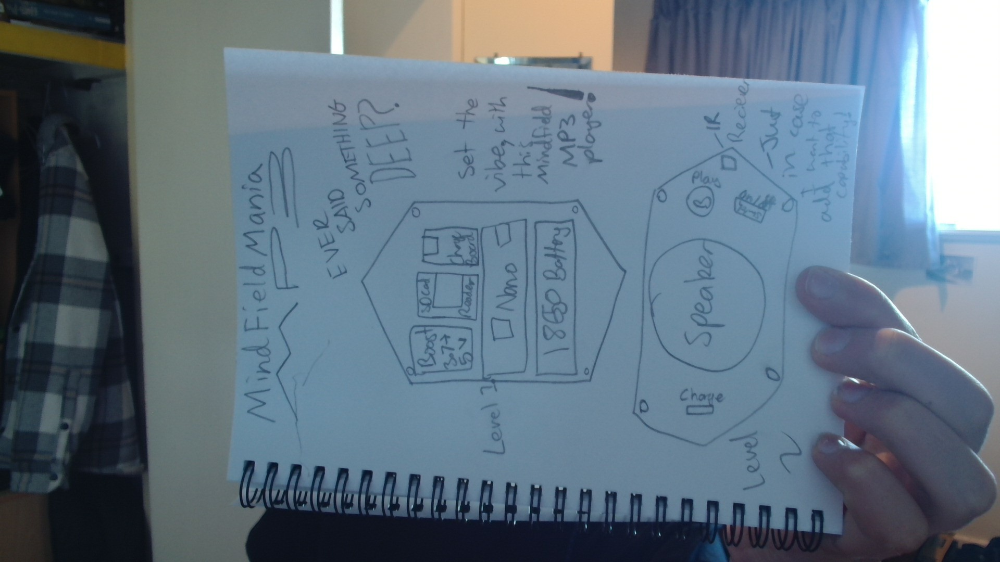
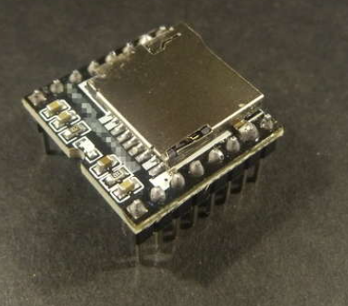
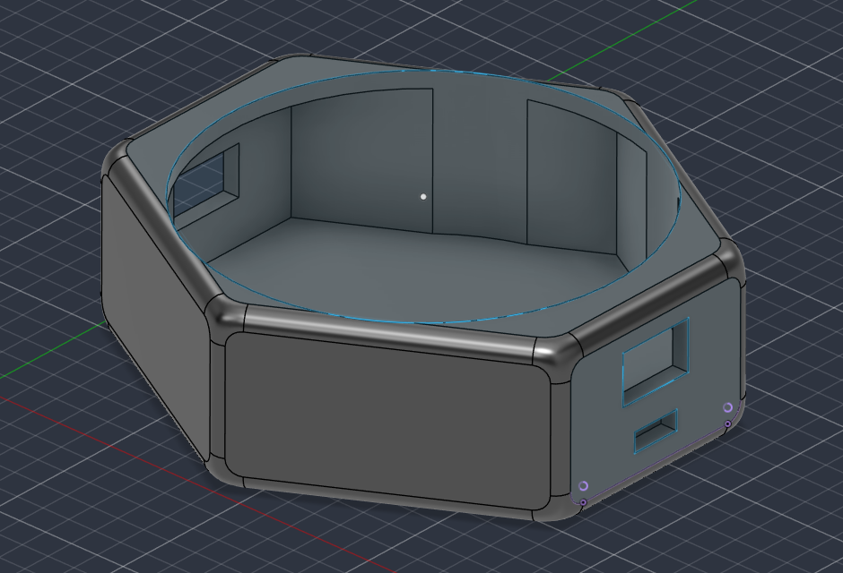
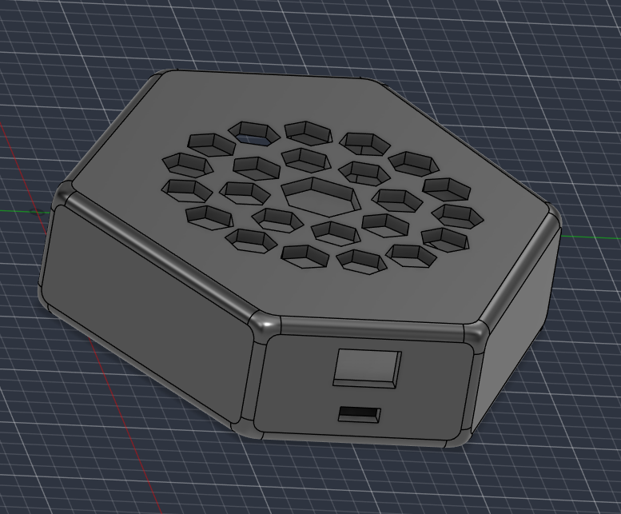

# MindfieldMania
A repository to contain my files for Week 3 of Hack Club's Half-Life!

This project is going to be a portable MP3 player whose sole purpose is to play the Mindfield intro on the click of a button. I will use it when people say really deep things that need the suspense that the Mindfield intro brings. Below this is a quick drawing I have sketched up, showing what the player will likely look like:

Here are the electronic parts that I will be using to create the player:
- Arduino Nano | Taking the input of the button to play the sound.
- DFPlayer | Reading the SD card and amplifying the sound for the speaker.
- 6 Ohm Speaker | Vibrating the air for us to hear as sound.
- 

  
- 18650 Battery | Containing charge for powering the system.
- TP4056 Charge Board | Regulating current for battery.
- Boost Converter | Converting the 3.7 V from the battery to the suitable 5V for the arduino.
- 

  
- Button | Triggering the mind field intro.
- Switch | Turning the device on and off.
- Wires, solder and other basic components.

To make the player the best project possible, I wanted it to be activated from a switch that is separate to the on/off switch. To do this, I would need to modify the code in Arduino IDE, as Steamakersblocks.com does not have the required functions. I took this as an opportunity to learn some C++/Arduino code so that I'm not reliant on Steamakersblocks's capabilites. You can find the modified version of the code in this repo.

I created a case for the player. There were two versions of the design:
- I created this first one before I had proper measurements of the speaker. I also didn't know how durable it would be.

- The second version was a modified version of first with several adjustments. I changed the size to make sure it could fit all of the parts, including the large 18650 battery and its charging parts. I also changed the top from being a circular hole to having hexagonal holes. I decided to not use a hexagon's stereotypical tessellation arrangement because it wouldn't be symmetrical and look good. Instead of that, I used Fusion360's circular pattern tool to revolve hexagons around the middle of the speaker area. I think that this looks pretty good.

Because I couldn't assemble by putting parts in and then the speaker, I split the case into two parts; the lid and the case. You can see it in this picture:

I also had to change a few things to do with position but I won't go into depth here. You can always find more information in the synced journal entries.
And as always, thanks for reading... ;)
